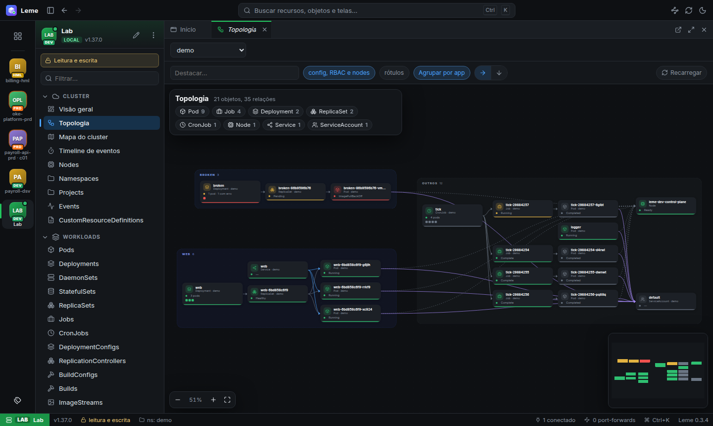
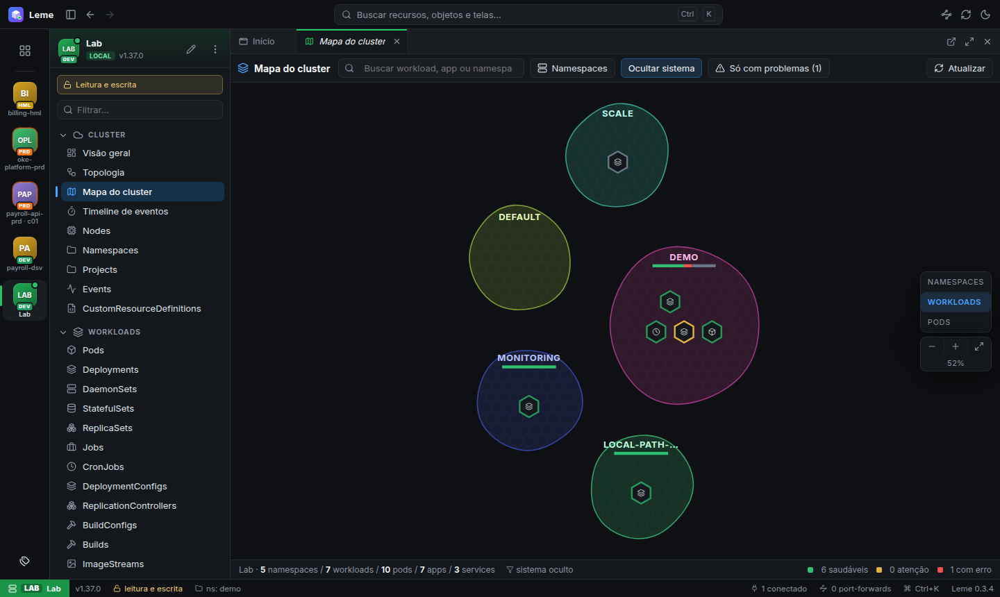

# Leme

[](https://github.com/jcottobboni/leme/actions/workflows/ci.yml)
[](https://github.com/jcottobboni/leme/actions/workflows/e2e.yml)
[](https://github.com/jcottobboni/leme/releases/latest)
[](https://github.com/jcottobboni/leme/releases)
[](LICENSE)
[](engine/go.mod)


*Steer your clusters, safely.*

**Leme** is Portuguese for the helm of a ship, the wheel the *kybernḗtēs* (helmsman) holds, the Greek
word that gave Kubernetes its name. It is an agentless desktop client for Kubernetes and OpenShift, built for people who operate many clusters
and need to be sure they are not about to break production.

> **Status:** early (v0.x, see the [changelog](CHANGELOG.md)). Linux (`.deb` + APT repository, AppImage) and Windows (installer). The UI is currently in Brazilian
> Portuguese; English is on the roadmap. [Leia em português](README.pt-BR.md).


## Why

- **Production-safe by default.** Every remote cluster opens **read-only**, enforced in the engine,
  not just hidden in the UI. Production contexts need you to type the context name to unlock writes.
  Every YAML change goes through a server-side dry-run, a diff and a confirmation.
- **OpenShift as a first-class citizen.** Routes, DeploymentConfigs, BuildConfigs, Builds,
  ImageStreams, Projects and an in-app OpenShift login (password or browser/SSO) that never touches
  your kubeconfig.
- **Security posture built in.** A 0–100 score per namespace or cluster, findings by severity, RBAC
  risks, a NetworkPolicy flow graph and simulator, plus optional Polaris, Kubescape and Trivy.
- **Many clusters, at a glance.** Pinned clusters with your own alias, short tag, color, icon and
  environment, so you always know where you are before you click.
- **Bring your k9s plugins.** Your k9s `plugins.yaml` works as it is, next to Leme's own YAML
  actions, links, CRD views and CEL rules, behind the same production guard.
- **Nothing leaves your machine.** No telemetry, no agent in the cluster, works air-gapped.

## Features

| Area | What you get |
|---|---|
| Clusters | Every kubeconfig context; nothing connects on its own; hotbar with per-cluster identity; read-only / read-write switch |
| Resources | Live grids for every built-in kind and CRD, details drawer, YAML editor with diff and dry-run, bulk actions |
| Workloads | Logs, shell (exec), port-forward, scale, restart, rollback with revision diff |
| Aggregated logs | All pods of a workload or label selector in one stream, colored per pod, following rollouts |
| Search | Ctrl+K across clusters with k9s syntax (`:deploy demo -l app=web`, `!text`, `/regex/`); JSONPath columns per kind |
| Compare and history | The same object in another cluster or namespace, side by side; local change history kept for 7 days |
| Overview | Capacity (usage × requests × limits × allocatable), workloads by health, namespaces table, top consumers, warnings |
| Topology | Object graph grouped by app, type filters, neighborhood highlight, focus mode |
| Cluster map | Namespaces as islands, apps as regions, workloads as tiles, with health and search; WebGL for large clusters (up to 25,000 workloads) with traffic edges |
| Timeline | Events grouped by namespace → workload → object, with density, filters and zoom |
| Metrics | Prometheus charts (CPU, memory, network, disk) with capacity/requests/limits reference lines |
| Helm | Releases, values, manifest, history, upgrade, rollback, uninstall; repositories and chart install |
| RBAC | My permissions matrix, "can I…?", "who can…?", subjects and bindings, Role/Binding templates |
| Security | Built-in rules, RBAC risks, NetworkPolicy analysis and simulator, optional external scanners |
| OpenShift | Routes, DeploymentConfigs, Builds, ImageStreams, Projects, OAuth login |
| Diagnosis | Offline analyzer: evidence and suggestion for common problems, per object and per cluster |
| Copilot (opt-in) | Claude, any OpenAI-compatible API or local Ollama; reads, explains and proposes fixes as reviewed diffs; anonymized, consented, audited |
| MCP server | `leme mcp` lets agents like Claude Code read clusters through Leme; writes only where you allow them, two steps, audited ([docs/mcp.md](docs/mcp.md)) |
| Observed traffic | Workload-to-workload connections from Caretta or Hubble metrics in Prometheus, in a panel, the Topology and the map ([docs](docs/integrations/traffic.md)) |
| Argo CD | Applications with sync/health, resources, history; Sync and Refresh as reviewed, audited changes ([docs](docs/integrations/argocd.md)) |
| Grafana / Prometheus | Detects Grafana, Prometheus and Thanos and opens them through a local port-forward in a sandboxed window ([docs](docs/integrations/grafana.md)) |
| Gateway API | Gateways and routes with status, Gateway → Route → Service in the topology, diagnosis of broken routes ([docs](docs/integrations/gateway-api.md)) |
| Flux | Kustomizations, HelmReleases and sources; reconcile, suspend and resume as reviewed, audited changes ([docs](docs/integrations/flux.md)) |
| Istio | Effective mTLS, weighted routes, DestinationRules, Gateways, offline `istioctl analyze` ([docs](docs/integrations/istio.md)) |
| Plugins | YAML actions, links, CRD views and CEL diagnosis rules; reads k9s plugins as they are; trusted per command, cluster access through a read-only-aware proxy ([docs/plugins.md](docs/plugins.md)) |

| Topology | Cluster map |
|---|---|
|  |  |

## Install

### APT (Debian, Ubuntu and derivatives), with automatic updates

```bash
curl -fsSL https://github.com/jcottobboni/leme/releases/latest/download/leme-archive-keyring.gpg -o leme.gpg
gpg --show-keys --with-colons leme.gpg | grep -q '^fpr:::::::::8230020B4E3AB4337EBE0D9588ED1FDA269D1375:' \
  && sudo install -m 644 leme.gpg /usr/share/keyrings/leme-archive-keyring.gpg && rm leme.gpg
echo "deb [signed-by=/usr/share/keyrings/leme-archive-keyring.gpg] https://github.com/jcottobboni/leme/releases/latest/download/ ./" \
  | sudo tee /etc/apt/sources.list.d/leme.list
sudo apt update && sudo apt install leme
```

New versions arrive with `sudo apt upgrade`. The repository is signed with the key
`8230 020B 4E3A B433 7EBE  0D95 88ED 1FDA 269D 1375` (also in [`packaging/leme-archive-keyring.asc`](packaging/leme-archive-keyring.asc)).

### Windows

Download `leme-setup-<version>.exe` from the [latest release](https://github.com/jcottobboni/leme/releases/latest) and run it
(per-user install, no admin rights needed). The installer is not code-signed yet, so Windows
SmartScreen asks for confirmation the first time: **More info → Run anyway**.

### macOS

Not packaged yet: the app builds and passes its smoke test on macOS in CI, but a usable package
needs Apple code signing and notarization.

### Manual (Linux)

Download the `.deb` or AppImage from the [releases page](https://github.com/jcottobboni/leme/releases) and check it against `SHA256SUMS`.
From 0.8.1 on, every package also carries a signed build provenance:
`gh attestation verify leme_<version>_amd64.deb --repo jcottobboni/leme`.

```bash
sudo apt install ./leme_<version>_amd64.deb
leme
```

The `.deb` sets up the Chromium sandbox. On Ubuntu 24.04+ the AppImage needs `--no-sandbox`.

The app reads your `KUBECONFIG` (or `~/.kube/config`). Optional tools are used if found on `PATH`:
`polaris`, `kubescape`, `trivy`.

## Build from source

Requirements: Go 1.27+, Node.js 24, and for tests Docker + kind.

```bash
make deps      # npm ci in app/
make run       # desktop app with your kubeconfig (remote clusters open read-only)
make dist      # .deb and AppImage in app/release/
```

See [docs/development.md](docs/development.md) for the test cluster, e2e tests and the UI sweep.

## How it works

A thin Electron shell starts a Go engine bound to `127.0.0.1` with a per-session token. The engine
keeps one informer cache per cluster (client-go) and streams row projections to the React UI over
WebSocket. Read-only mode, production protection and every mutation check live in the engine.
Details in [docs/architecture.md](docs/architecture.md); the security model is in [SECURITY.md](SECURITY.md).

## Contributing

Issues and pull requests are welcome. Read [CONTRIBUTING.md](CONTRIBUTING.md) and the
[Code of Conduct](CODE_OF_CONDUCT.md) first; the most
important rule is that tests only ever run against the local kind cluster.

## License

[Apache License 2.0](LICENSE). Third-party components are listed in
[THIRD_PARTY_NOTICES.md](THIRD_PARTY_NOTICES.md).

Kubernetes is a registered trademark of The Linux Foundation. OpenShift is a trademark of Red Hat, Inc.
This project is not affiliated with or endorsed by either.
