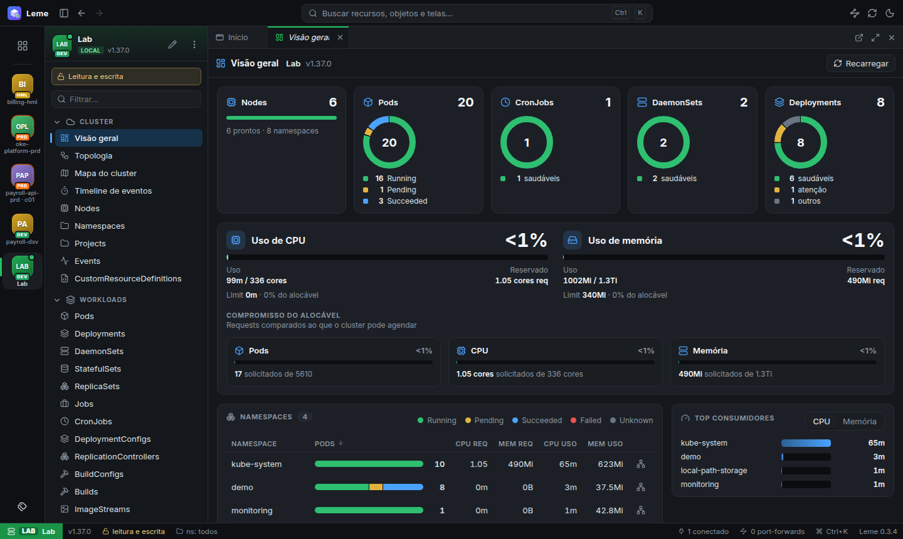

# Leme

[](https://github.com/jcottobboni/leme/actions/workflows/ci.yml)
[](https://github.com/jcottobboni/leme/actions/workflows/e2e.yml)
[](https://github.com/jcottobboni/leme/releases/latest)
[](https://github.com/jcottobboni/leme/releases)
[](LICENSE)
[](engine/go.mod)


*O leme dos seus clusters, com segurança.*

O nome vem do timoneiro: "Kubernetes" é a palavra grega *kybernḗtēs*, quem segura o leme do navio.
O Leme é um cliente desktop de Kubernetes e OpenShift, sem agente no cluster, feito para quem opera muitos
clusters e precisa ter certeza de que não vai quebrar produção.

> **Status:** inicial (v0.3.x). Linux (`.deb` + repositório APT, AppImage) e Windows (instalador). A interface está em português;
> inglês está no roadmap. [Read in English](README.md).



## Por quê

- **Seguro para produção por padrão.** Todo cluster remoto abre em **somente leitura**, e isso é
  imposto pelo engine, não só escondido na tela. Contextos de produção exigem digitar o nome do
  contexto para liberar a escrita. Toda alteração de YAML passa por dry-run no servidor, diff e
  confirmação.
- **OpenShift de primeira classe.** Routes, DeploymentConfigs, BuildConfigs, Builds, ImageStreams,
  Projects e login OpenShift dentro do app (senha ou navegador/SSO), sem mexer no seu kubeconfig.
- **Postura de segurança embutida.** Nota de 0 a 100 por namespace ou cluster, achados por
  severidade, riscos de RBAC, grafo e simulador de NetworkPolicy, e Polaris, Kubescape e Trivy
  opcionais.
- **Muitos clusters, de relance.** Clusters fixados com apelido, sigla, cor, ícone e ambiente seus,
  para saber onde você está antes de clicar.
- **Nada sai da sua máquina.** Sem telemetria, sem agente no cluster, funciona sem internet.

## Funcionalidades

| Área | O que tem |
|---|---|
| Clusters | Todos os contextos do kubeconfig; nada conecta sozinho; hotbar com identidade por cluster; chave somente leitura / leitura e escrita |
| Recursos | Grids ao vivo de todos os tipos nativos e CRDs, painel de detalhes, editor YAML com diff e dry-run, ações em lote |
| Workloads | Logs, shell (exec), port-forward, scale, restart, rollback com diff de revisões |
| Visão geral | Capacidade (uso × requests × limits × alocável), workloads por saúde, tabela de namespaces, maiores consumidores, warnings |
| Topologia | Grafo de objetos agrupado por app, filtros por tipo, destaque da vizinhança, modo foco |
| Mapa do cluster | Namespaces como ilhas, apps como regiões, workloads como blocos, com saúde e busca |
| Timeline | Eventos agrupados por namespace → workload → objeto, com densidade, filtros e zoom |
| Métricas | Gráficos do Prometheus (CPU, memória, rede, disco) com linhas de capacidade, requests e limits |
| Helm | Releases, values, manifest, histórico, upgrade, rollback, uninstall; repositórios e instalação de charts |
| RBAC | Matriz das minhas permissões, "posso…?", "quem pode…?", subjects e bindings, modelos de Role/Binding |
| Segurança | Regras próprias, riscos de RBAC, análise e simulador de NetworkPolicy, scanners externos opcionais |
| OpenShift | Routes, DeploymentConfigs, Builds, ImageStreams, Projects, login OAuth |

## Instalação

### APT (Debian, Ubuntu e derivados), com atualização automática

```bash
curl -fsSL https://github.com/jcottobboni/leme/releases/latest/download/leme-archive-keyring.gpg \
  | sudo tee /usr/share/keyrings/leme-archive-keyring.gpg > /dev/null
echo "deb [signed-by=/usr/share/keyrings/leme-archive-keyring.gpg] https://github.com/jcottobboni/leme/releases/latest/download/ ./" \
  | sudo tee /etc/apt/sources.list.d/leme.list
sudo apt update && sudo apt install leme
```

As novas versões chegam com `sudo apt upgrade`. O repositório é assinado com a chave
`8230 020B 4E3A B433 7EBE  0D95 88ED 1FDA 269D 1375` (também em [`packaging/leme-archive-keyring.asc`](packaging/leme-archive-keyring.asc)).

### Windows

Baixe o `leme-setup-<versão>.exe` na [última release](https://github.com/jcottobboni/leme/releases/latest) e execute
(instalação por usuário, sem precisar de administrador). O instalador ainda não é assinado
digitalmente, então o SmartScreen pede confirmação na primeira vez: **Mais informações → Executar assim mesmo**.

### macOS

Ainda sem pacote: o app compila e passa no teste de fumaça em macOS no CI, mas um pacote utilizável
precisa de assinatura e notarização da Apple.

### Manual (Linux)

Baixe o `.deb` ou o AppImage na [página de releases](https://github.com/jcottobboni/leme/releases) e confira com o `SHA256SUMS`.

```bash
sudo apt install ./leme_<versão>_amd64.deb
leme
```

O `.deb` configura o sandbox do Chromium. No Ubuntu 24.04+ o AppImage precisa de `--no-sandbox`.

O app lê o seu `KUBECONFIG` (ou `~/.kube/config`). Ferramentas opcionais são usadas se estiverem
no `PATH`: `polaris`, `kubescape`, `trivy`.

## Compilar do código

Requisitos: Go 1.27+, Node.js 24 e, para os testes, Docker + kind.

```bash
make deps      # npm ci em app/
make run       # app desktop com o seu kubeconfig (clusters remotos abrem em somente leitura)
make dist      # .deb e AppImage em app/release/
```

O cluster de teste, os testes e2e e a varredura de UI estão em [docs/development.md](docs/development.md).

## Como funciona

Uma casca Electron fina inicia um engine em Go que escuta só em `127.0.0.1`, com token por sessão.
O engine mantém um cache de informers por cluster (client-go) e envia projeções de linha para a UI
React por WebSocket. O modo somente leitura, a proteção de produção e todas as checagens de
alteração ficam no engine. Detalhes em [docs/architecture.md](docs/architecture.md); o modelo de
segurança está em [SECURITY.md](SECURITY.md).

## Contribuir

Issues e pull requests são bem-vindos. Leia o [CONTRIBUTING.md](CONTRIBUTING.md) antes; a regra mais
importante é que os testes só rodam contra o cluster kind local.

## Licença

[Apache License 2.0](LICENSE). Os componentes de terceiros estão em
[THIRD_PARTY_NOTICES.md](THIRD_PARTY_NOTICES.md).

Kubernetes é marca registrada da The Linux Foundation. OpenShift é marca da Red Hat, Inc. Este
projeto não é afiliado nem endossado por nenhuma delas.
